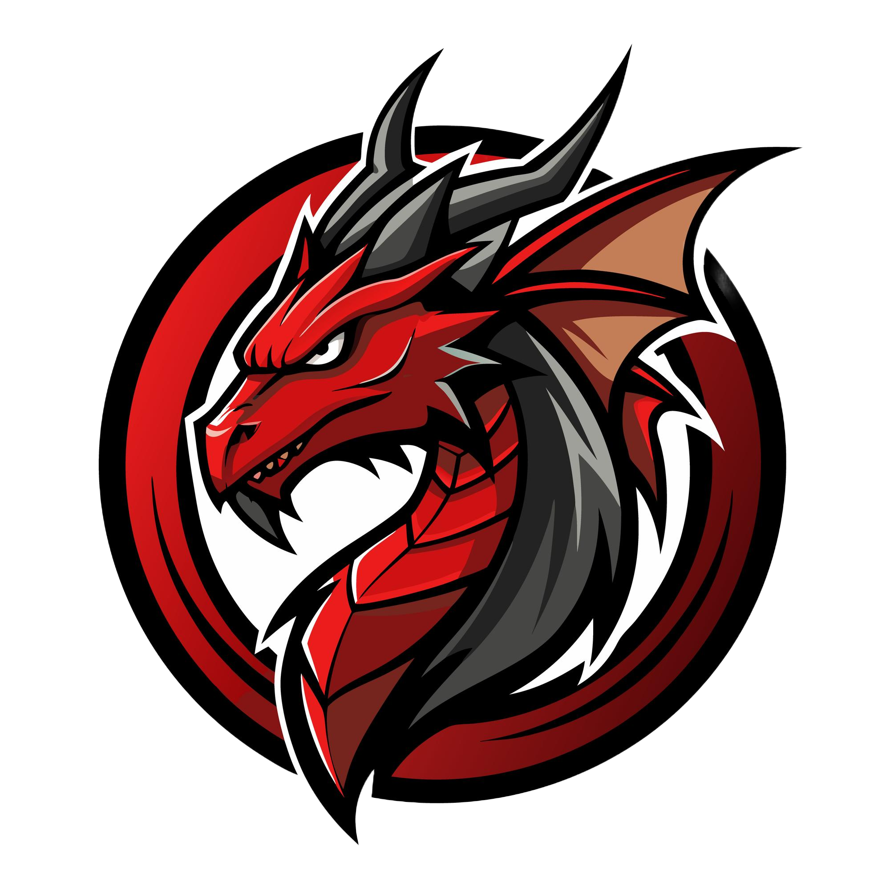

<div align="center">

  <a href="https://github.com/ehsanrashid/DON">
    
  </a>

  <h1>DON</h1>

  A powerful UCI chess engine combining classical search with neural-network evaluation.
  <br>
  <strong>[Explore DON docs »][wiki-link]</strong>
  <br>
  <br>
  [![Build][build-badge]][build-link]
  [![License][license-badge]][license-link]
  <br>
  [![Release][release-badge]][release-link]
  [![Commits][commits-badge]][commits-link]
  <br>
  [![Website][website-badge]][website-link]
  <br>
  [Report bug][issue-link]

  <a href="https://github.com/ehsanrashid/DON">
    
  </a>
</div>

## Overview

[DON][website-link] is a **free and powerful UCI chess engine**
designed to analyze chess positions and find the strongest moves.

DON is a command-line chess engine and **does not include a graphical user interface (GUI)**.
A chess GUI provides the graphical chessboard, allows you to play moves,
and displays the engine's analysis.

DON can be used with various independently developed chess GUIs that support the UCI protocol.
Refer to the documentation of your preferred GUI for instructions on configuring and using DON.

For additional information, see the DON [documentation][wiki-usage-link].

## Files

The DON distribution includes the following files and directories:

- [README.md][readme-link] — The file you are currently reading,
  containing an introduction to DON and basic usage information.
- [Copying.txt][license-link] — Contains the GNU General Public License, version 3 (GPL-3.0).
- [src][src-link] — Contains the complete DON source code, including a Makefile
  for building the engine on Unix-like systems.
- **NNUE network file (`.nnue`)** — Contains the neural network used for NNUE evaluation.
  In binary distributions, the network is embedded directly into the engine executable
  and does not need to be provided separately.

## Contributing

__See [Contributing Guide](CONTRIBUTING.md).__

### Improving the Code

The [Chess Programming Wiki][programming-link] provides detailed explanations and background information on many of the algorithms, techniques, and concepts used in chess engines.

The [DON Chess Programming Guide][programming-don-link] covers various features and techniques implemented in DON. While it provides insight into DON's architecture and design, it is intended as a general guide rather than a comprehensive reference to every detail of DON's implementation.

Exploring both resources can help you understand the underlying concepts, study DON's design decisions, and contribute to its development.

## Compiling DON

DON supports a wide range of platforms and hardware configurations, including 32-bit and 64-bit CPUs, various instruction-set extensions, and big-endian architectures such as PowerPC.

On Unix-like systems, DON can be compiled directly from the source code using the Makefile provided in the `src` directory.

To explore the available build options, run:

```bash
cd src
make help
```

This displays the available Makefile targets along with their descriptions.

For most modern Intel and AMD processors, a profile-guided optimized (PGO) build can be created with:

```bash
cd src
make -j profile-build
```

For detailed compilation instructions, including platform-specific configurations and supported architectures, see the [compilation documentation][wiki-compile-link].

For information about the UCI commands supported by DON, see the [UCI commands documentation][wiki-uci-link].

## Terms of Use

DON is free and open-source software distributed under the [**GNU General Public License, version 3 (GPL-3.0)**][license-link].

The GPL v3 grants you the freedom to use, study, modify, and redistribute DON.
You may distribute it among friends, make it available for download on your website,
sell it, include it in a larger software package, or use it as the basis for your own software projects.

When redistributing DON, you must comply with the applicable GPL v3 requirements.
These include providing recipients with a copy of the license and, when distributing binaries,
making the corresponding complete source code available under the license terms.
The source code must correspond to the exact version of the binary being distributed.

If you distribute a modified version of DON, your modifications must also comply with the GPL v3 requirements,
including making the modified source code available under the license terms.

For the complete terms, conditions, and obligations, please refer to the [GNU General Public License, version 3][license-link].

## Acknowledgements

DON uses neural networks trained on data provided by the [Leela Chess Zero
project][lc0-data-link], which is made available under the [Open Database License][odbl-link] (ODbL).

[build-link]:           https://github.com/ehsanrashid/DON/actions/workflows/DON.yml
[commits-link]:         https://github.com/ehsanrashid/DON/commits/main
[issue-link]:           https://github.com/ehsanrashid/DON/issues/new?assignees=&labels=&template=BUG-REPORT.yml
[license-link]:         https://github.com/ehsanrashid/DON/blob/main/Copying.txt
[programming-link]:     https://www.chessprogramming.org/Main_Page
[programming-don-link]: https://www.chessprogramming.org/DON
[readme-link]:          https://github.com/ehsanrashid/DON/blob/main/README.md
[release-link]:         https://github.com/ehsanrashid/DON/releases/latest
[src-link]:             https://github.com/ehsanrashid/DON/tree/main/src
[uci-link]:             https://backscattering.de/chess/uci/
[website-link]:         https://DON.org
[wiki-link]:            https://github.com/ehsanrashid/DON/wiki
[wiki-compile-link]:    https://github.com/ehsanrashid/DON/wiki/Compiling-from-source
[wiki-uci-link]:        https://github.com/ehsanrashid/DON/wiki/UCI-&-Commands
[wiki-usage-link]:      https://github.com/ehsanrashid/DON/wiki/Download-and-usage
[worker-link]:          https://github.com/ehsanrashid/DON/wiki/Running-the-worker
[lc0-data-link]:        https://storage.lczero.org/files/training_data
[odbl-link]:            https://opendatacommons.org/licenses/odbl/odbl-10.txt

[DON-color-logo]:       ./DON-color-logo.png
[DON-black-logo]:       ./DON-black-logo.png
[build-badge]:          https://img.shields.io/github/actions/workflow/status/ehsanrashid/DON/DON.yml?branch=main&style=for-the-badge&label=DON&logo=github
[commits-badge]:        https://img.shields.io/github/commits-since/ehsanrashid/DON/latest?style=for-the-badge
[license-badge]:        https://img.shields.io/github/license/ehsanrashid/DON?style=for-the-badge&label=license&color=success
[release-badge]:        https://img.shields.io/github/v/release/ehsanrashid/DON?style=for-the-badge&label=official%20release
[website-badge]:        https://img.shields.io/website?style=for-the-badge&down_color=red&down_message=Offline&label=website&up_color=success&up_message=Online&url=https%3A%2F%2FDON.org
